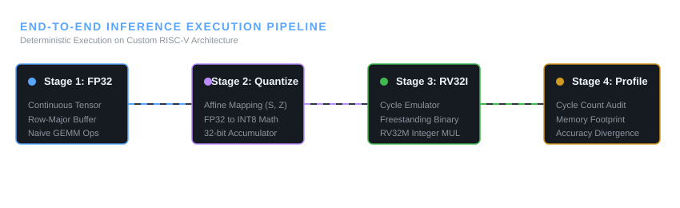

# Bare-Metal Neural Network Inference Engine on RISC-V Architecture

<p align="left">
  
  
  
  
  
</p>

An academic-grade, freestanding C++ inference runtime engineered from first principles for neural network execution on simulated **RISC-V (RV32I/M)** processors.

This research project explores the intersection of systems engineering and embedded deep learning through deterministic fixed-point arithmetic, reduced-precision inference, memory-efficient tensor layouts, and execution-cycle measurement.

---

## ⚡ Execution Pipeline Architecture

<p align="center">
  
</p>

---

## 🔬 Core Architectural Pillars

### 1. Memory-Efficient Tensor Storage
- **Contiguous Row-Major Buffering:** Reduces pointer indirection and improves spatial locality.
- **Predictable Memory Usage:** Designed to support embedded and resource-constrained execution.
- **Allocation-Aware Kernels:** Avoids dynamic allocation in performance-critical loops where implemented.

### 2. Affine Fixed-Point INT8 Quantization

Real values are mapped to quantized integers using a scale factor \(S\) and zero-point \(Z\):

\[
q = \operatorname{clamp}\left(\operatorname{round}\left(\frac{r}{S}\right)+Z,-128,127\right)
\]

- Converts FP32 values into INT8 representations.
- Uses 32-bit accumulators for integer matrix operations.
- Requires appropriate scaling, rounding, and overflow handling during implementation.

### 3. RISC-V Execution and Cycle Profiling
- RV32I register and instruction execution modeling.
- Optional RV32M integer multiplication support.
- Instruction-cycle accounting and execution profiling.
- Memory-footprint and numerical-accuracy comparisons.

**Note:** Cycle accuracy and hardware instruction support depend on the simulator and implementation. These properties must be verified through tests and benchmarks.

---

## 📁 Repository Anatomy

```text
riscv-edge-ai/
├── docs/
│   └── assets/
│       └── pipeline.svg
├── include/
│   └── engine/
│       └── tensor.hpp
├── src/
├── tests/
│   ├── CMakeLists.txt
│   └── test_main.cpp
├── CMakeLists.txt
└── main.cpp
```

---

## 📊 Roadmap

| Phase | Milestone | Target Date | Status |
|---|---|---|---|
| 01 | CMake scaffolding and test harness | Oct 16 | Done |
| 02 | Contiguous row-major tensor | Oct 17 | Done |
| 03 | FP32 baseline GEMM kernel | Oct 18 | In Progress |
| 04 | Affine INT8 quantization | Oct 25 | Planned |
| 05 | RV32I virtual machine | Nov 05 | Planned |
| 06 | Freestanding cross-compiled runtime | Nov 12 | Planned |
| 07 | Cycle audit and accuracy report | Nov 26 | Planned |

*Update milestone statuses and dates to reflect verified project progress.*

---

## 🛠️ Build and Verification

Requirements: CMake, a C++17 compiler, and a compatible test configuration.

```bash
# Configure and build
cmake -S . -B build
cmake --build build -j"$(nproc)"

# Run the executable if the target exists
./build/engine_runner

# Run tests
ctest --test-dir build --output-on-failure
```

Executable paths depend on the CMake target configuration.

---

## 🎯 Research Objectives

- Evaluate FP32 versus INT8 numerical accuracy.
- Measure inference latency and instruction counts.
- Investigate memory footprint under embedded constraints.
- Compare software and hardware-style integer multiplication models.
- Document reproducible experiments and limitations.

## 📜 License

Add a LICENSE file before distributing this project publicly.
