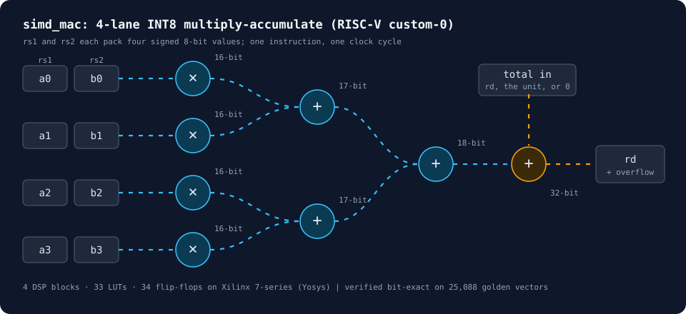
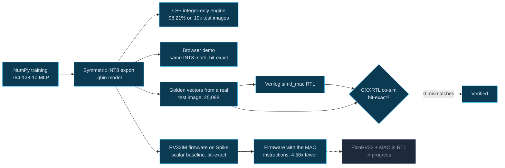
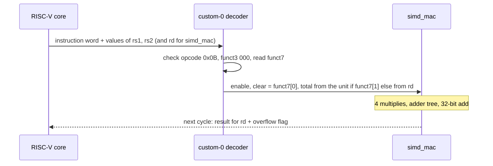
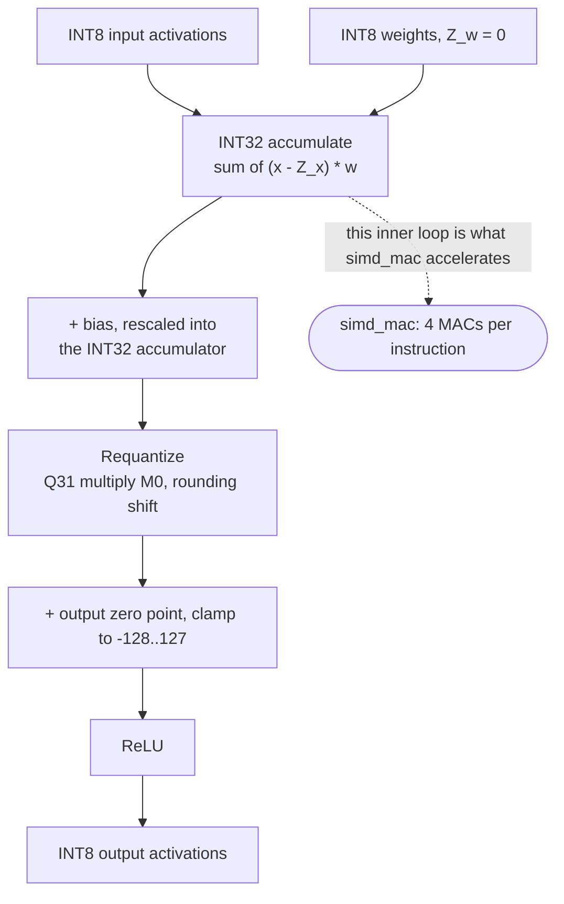
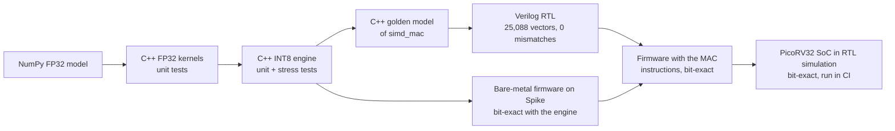
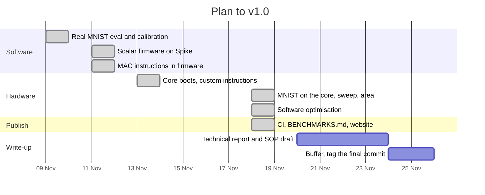

# Riscv-Edge-AI

Integer-only neural network inference for small RISC-V cores, with a custom 4-lane INT8 multiply-accumulate (MAC) instruction designed in Verilog.

The goal is simple: run useful AI models on cheap microcontrollers that have no floating-point unit. A 32-bit RISC-V register can hold four 8-bit values, but a plain RV32IM core multiplies them one at a time. This project builds the software side (INT8 quantization and a fixed-point runtime) and the hardware side (a SIMD MAC unit mapped to the RISC-V `custom-0` opcode), and verifies that both produce exactly the same results.

<p align="center">
  
</p>

<p align="center">
  <a href="https://sajedulislam5840.github.io/riscv-edge-ai/"></a>
</p>

<p align="center">
  <a href="https://github.com/sajedulislam5840/riscv-edge-ai/actions/workflows/ci.yml"></a>
  <br/>
  <a href="https://sajedulislam5840.github.io/riscv-edge-ai/"><b>Live demo</b></a> ·
  <a href="#verified-results">Results</a> ·
  <a href="#how-it-fits-together">Architecture</a> ·
  <a href="#reproduce">Reproduce</a> ·
  <a href="#roadmap">Roadmap</a>
</p>

---

## Status

| Part | State |
|---|---|
| FP32 reference kernels (GEMM, ReLU, bias, softmax) | Done, unit tested |
| INT8 quantization library (affine, per-channel, Q31 requantization, BN folding, pooling, `.qbin` format) | Done, unit tested on host |
| SIMD MAC RTL (`hardware/rtl/simd_mac.v`) + `custom-0` decoder wrapper | Done, synthesized and verified against golden vectors |
| INT8 evaluation on the real MNIST test set (calibrated activations) | Done: 98.21% INT8 vs 98.23% FP32 |
| Bare-metal RV32IM firmware on Spike, scalar baseline | Done: 822,232 instructions per inference (435,282 with the loop unrolled), outputs match the C++ engine |
| Internal-accumulator instructions (`simd_macc` / `simd_macz`) for two-read-port cores | Done: wrapper verified on 25,088 instructions, costs 1 LUT and no Fmax |
| Same firmware with the custom MAC instructions | Done: 95,120 instructions per inference, **4.58x fewer** than an equally unrolled scalar loop, outputs unchanged |
| MAC unit inside a RISC-V core (PicoRV32), cycle-accurate RTL simulation | Done: bit-exact, **4.47x fewer clock cycles** than an unrolled scalar loop, area and Fmax measured |
| CI on every push: unit tests, RTL co-simulation, synthesis and Fmax, Spike, whole-SoC simulation | Done: green, and it fails if a recorded number drifts |
| `BENCHMARKS.md` and the web demo numbers | Done: generated from the recorded results, checked in CI |
| Technical report (4 pages) | Planned, 20 to 23 Nov |

Everything listed as done below can be reproduced with the commands in [Reproduce](#reproduce).

---

## How it fits together



Solid boxes are done and verified; dashed boxes are in progress or planned.

---

## Verified results

### SIMD MAC hardware

The unit takes two 32-bit registers, each holding four signed INT8 values, and computes

```
rd = (clear ? 0 : rd) + a0*b0 + a1*b1 + a2*b2 + a3*b3
```

in one clock cycle: four 8x8 signed multipliers, a two-level adder tree, a 32-bit accumulator and an overflow flag.

**Synthesis (Yosys):**

| Target | Multipliers | Logic | Flip-flops | Carry |
|---|---|---|---|---|
| Xilinx 7-series (`synth_xilinx`) | 4 DSP48E1 | 33 LUTs | 34 | 8 CARRY4 |
| Lattice iCE40 UP5K (`synth_ice40 -dsp`) | 4 SB_MAC16 | 67 LUT4 | 34 | 31 SB_CARRY |

**Post-route clock speed** (`hardware/scripts/fmax.sh`, nextpnr, three placement seeds). Each design is timed inside a harness with registered inputs and outputs, so the critical path is the design's own: for the unit, multipliers, adder tree and 32-bit accumulate in one cycle; for the wrapper, the instruction decoder in front of that.

| FPGA | MAC unit alone | Unit + custom-0 decoder (wrapper) |
|---|---|---|
| Lattice iCE40 UP5K | 47.0 MHz (all three seeds) | 35.3 to 36.7 MHz |
| Lattice ECP5-25k | 64.3 to 68.7 MHz | 65.4 to 67.8 MHz |

On iCE40 the decoder's opcode and funct7 checks add logic levels in front of the adder; a core that decodes in an earlier pipeline stage would hide most of that.

Xilinx 7-series timing needs Vivado and has not been run. Pipelining the adder tree would raise Fmax at the cost of one cycle of latency; that is on the design-space list.

**RTL verification:** `tests/gen_simd_vectors.cpp` takes the INT8 first-layer weights and a real MNIST test image and generates **25,088 test vectors**, one per instruction the firmware would issue: 128 neurons x 196 four-byte chunks, with the accumulator chained from chunk to chunk. It also checks, for every neuron, that the MAC's raw-byte result plus the folded zero-point term equals the engine's layer accumulator. The Verilog RTL, compiled to C++ with Yosys CXXRTL, matches on **all 25,088 vectors (0 mismatches)**. As a sanity check of the check itself, flipping one adder in the RTL produces 24,444 mismatches.

The custom-0 wrapper is verified the same way, as a real instruction stream (`hardware/tb/cxxrtl_cosim_wrapper.cpp`): all 25,088 vectors issued as `simd_macz` / `simd_macc` with random garbage on the `rd` input and about 3,100 idle cycles and unrelated instructions mixed in, then again as `simd_mac_clr` / `simd_mac`. Both passes: **0 mismatches**. Breaking the accumulator feedback, or making `simd_macz` forget to clear, is caught (about 24,900 mismatches each).

**ISA encoding** (R-type, opcode `0x0B` / `custom-0`):

| Instruction | funct7 | funct3 | Operation |
|---|---|---|---|
| `simd_mac` | `0000000` | `000` | `rd = rd + dot4(rs1, rs2)` |
| `simd_mac_clr` | `0000001` | `000` | `rd = dot4(rs1, rs2)` |
| `simd_macc` | `0000010` | `000` | `acc = acc + dot4(rs1, rs2); rd = acc` |
| `simd_macz` | `0000011` | `000` | `acc = dot4(rs1, rs2); rd = acc` |

`simd_macc` / `simd_macz` keep the running total inside the unit, so they read only two registers (see Design notes).

**How the core talks to the unit** (`simd_mac_wrapper.v`, one-cycle latency, no stalls):



Software can emit the instruction with the standard binutils `.insn` directive, without modifying the compiler:

```c
asm volatile(".insn r 0x0B, 0, 1, %0, %1, %2" : "=r"(acc) : "r"(a), "r"(b));
```

`hardware/include/simd_mac_isa.h` wraps this and provides a plain C fallback for non-RISC-V builds.

### Quantization library

- 7 test suites (FP32 kernels, quantization, stress/overflow cases) pass with `ctest`.
- INT8 weights take 4x less memory than FP32 (101.6 KB vs 406.4 KB for the 784-128-10 MLP).
**MNIST test set, 10,000 images** (`benchmarks/mnist/run_benchmark.cpp`). Activation scales are calibrated on 2,000 training images; the test set is only used for the final numbers.

| Configuration | Accuracy |
|---|---|
| FP32 reference | 98.23% |
| INT8 weights, FP32 activations | 98.23% |
| **INT8 end to end, integer-only inference** (min/max calibration) | **98.21%** |
| INT8 end to end, 99.99th-percentile clipping of the hidden layer | 98.26% |

INT8 and FP32 predict the same class on 99.84% of test images (9,984 of 10,000). The INT8 result was cross-checked with an independent NumPy implementation of the same integer pipeline, which also gives 98.21%. Min/max calibration was chosen as the main configuration before looking at test results; the percentile row is shown for comparison only.

Weights are quantized symmetrically (zero point 0, per tensor), which is what the MAC unit assumes. An asymmetric export of the same weights reaches 98.20%, so symmetric quantization costs nothing here.

### Bare-metal RV32IM firmware

`firmware/` runs the whole network on a simulated RV32IM processor (Spike): freestanding C, integer-only, no heap, no standard library, weights compiled in as constant arrays. On the ten example test images (one per digit) it predicts every label correctly, and every output byte matches the C++ engine; the firmware checks this itself and exits with an error otherwise.

The firmware runs the network five times per image and checks every output byte of all five against the engine:

| Version (RV32IM, `gcc -O2`) | Instructions per inference | Per multiply-accumulate |
|---|---|---|
| Scalar C, plain loop | 822,232 | about 8.1 |
| Scalar C, loop unrolled 16 times | 435,282 | about 4.3 |
| `simd_mac_clr` + `add` | 187,598 | about 7.4 per 4 |
| `simd_macz` / `simd_macc` | 161,500 | about 6.4 per 4 |
| `simd_macz` / `simd_macc`, loop unrolled 8 times | 95,120 | about 3.7 per 4 |

The fair comparison is between the two unrolled versions, since unrolling helps both: **4.58x fewer instructions** with the custom instructions (95,120 against 435,282). Against the plain scalar loop the same code is 8.6x fewer, but that number mixes the effect of the hardware with the effect of unrolling.

101,632 multiply-accumulates per inference; code and model take about 112 KB. Spike runs the custom-0 instructions through an extension library with the RTL's semantics (`firmware/spike_ext/`), checked by `firmware/isa_test.c` (19,005 checks against a C reference).

What the numbers mean, and what they do not:

- Spike executes one instruction per step, so `rdcycle` equals `rdinstret`: these are exact **instruction counts**, not pipeline cycles. Cycle-accurate numbers come from running the same firmware on a RISC-V core in RTL simulation (next section).
- Both sides are compiled C at `-O2`, not hand-written assembly. The scalar side is given the same effort as the MAC side: both loops are unrolled, and the scalar loop uses the per-neuron weight layout and the offline zero-point correction too. Unrolling further gives diminishing returns (the scalar loop went from 8 to 16 times, 454,257 to 435,282 instructions).
- Instruction counts depend on how the compiler treats the code. The layer functions are forced inline and the per-image functions are kept separate, so the counts follow from the source and do not change when unrelated code is added.
- The weights are packed four per word per neuron for the MAC versions; the per-neuron zero-point correction is computed offline (see Design notes).

### PicoRV32 core in RTL simulation

The same firmware binary runs on [PicoRV32](https://github.com/YosysHQ/picorv32) (RV32IM with its fast multiplier, divider and barrel shifter, no caches) with the MAC unit attached through its PCPI interface (`hardware/soc/`). The whole SoC is simulated cycle by cycle from the Verilog with Yosys CXXRTL. All ten example images are **bit-exact** against the C++ engine for all five versions, and the instruction counts match the Spike run exactly. Clock cycles for one inference, memory answering with no extra wait states:

| Version | Instructions | Clock cycles | Cycles vs plain scalar |
|---|---|---|---|
| Scalar C, plain loop | 822,232 | 4,416,182 | 1x |
| Scalar C, loop unrolled | 435,282 | 2,583,289 | 1.71x fewer |
| `simd_mac_clr` + `add` | 187,598 | 1,014,656 | 4.35x fewer |
| `simd_macz` / `simd_macc` | 161,500 | 908,620 | 4.86x fewer |
| `simd_macz` / `simd_macc`, loop unrolled | 95,120 | 577,451 | 7.65x fewer |

**The fair speed-up is 4.47x**: 2,583,289 cycles for the unrolled scalar loop against 577,451 for the unrolled MAC loop. The speed-up in cycles is a little below the one in instructions (4.58x) because a custom instruction goes through the PCPI handshake: the adapter issues it and returns the result a cycle later, so the MAC loop averages 6.1 cycles per instruction against 5.9 for the scalar loop. The same scalar code on the core **without** the unit takes exactly the same number of cycles, so the unit does not slow down ordinary code.

**Slower memory.** The testbench adds wait states to every memory access. Same binary, image 0, clock cycles per inference:

| Wait states | Unrolled scalar | Unrolled MAC | Speed-up |
|---|---|---|---|
| 0 | 2,583,289 | 577,451 | 4.47x |
| 1 | 3,128,982 | 703,428 | 4.45x |
| 2 | 3,674,675 | 854,813 | 4.30x |
| 4 | 4,970,429 | 1,158,687 | 4.29x |
| 8 | 7,561,937 | 1,766,435 | 4.28x |
| 16 | 12,744,953 | 2,981,931 | 4.27x |

The speed-up barely moves. PicoRV32 has no cache and fetches every instruction from memory, so memory time grows with the instruction count, and cutting instructions by 4.6x cuts memory time by about as much. A core with caches or tightly coupled memory would behave differently; that is not measured here. The plain-loop and `simd_mac_clr` columns for each wait state are printed by `hardware/scripts/soc_sweep.sh`.

**What was tried in software.** Unrolling is where the gain is: the unrolled scalar loop is 1.71x faster than the plain one, and the unrolled MAC loop is 1.57x faster than the plain MAC loop. Loading each activation word once for two neurons does not help with these instructions, because the internal accumulator holds only one running total; with `simd_mac_clr` and an `add` per neuron it would cost about 3.5 instructions per word against about 3 for the unrolled internal-accumulator loop (an estimate from the instruction counts, not a measurement, so it was not built).

**Area and clock speed.** Yosys and nextpnr (`hardware/scripts/soc_synth.sh`). The core is built with the fast multiplier (`ENABLE_FAST_MUL`), divider and barrel shifter. ECP5 numbers are after place-and-route, three seeds; iCE40 is synthesis only, because the core has more pins than the UP5K package and the HX8K has no DSP blocks.

| | LUT4 | Flip-flops | DSP blocks | Fmax (ECP5, 3 seeds) |
|---|---|---|---|---|
| Core without the unit, ECP5 | 1,942 | 924 | 4 | 82.1 to 84.8 MHz |
| Core with the unit, ECP5 | 2,487 | 958 | 8 | 69.7 to 72.8 MHz |
| MAC unit alone, ECP5 | 419 | 34 | 4 | |
| Core without the unit, iCE40 | 2,734 | 931 | 4 | |
| Core with the unit, iCE40 | 2,785 | 965 | 8 | |
| MAC unit alone, iCE40 | 76 | 34 | 4 | |

What this says:

- The unit costs 34 flip-flops and 4 DSP blocks on both devices. LUTs differ a lot: 76 on iCE40, where each `SB_MAC16` also does the adding and accumulating, against 419 on ECP5, where `MULT18X18D` has no accumulator and the adder tree and the 32-bit total go into logic.
- The unit lowers the core's clock speed by about 12 MHz (14%, best seed of three), because the multiply, adder tree and accumulate happen in one cycle and that path is now the longest one. At those clock speeds, one inference with the unrolled scalar loop takes about 30.5 ms on the core alone (2,583,289 cycles at 84.8 MHz) and about 7.9 ms with the unit (577,451 cycles at 72.8 MHz): roughly **3.8x faster in time**, not 4.5x. A two-stage multiplier would recover clock speed at the price of one more cycle per MAC instruction; that is the obvious next experiment.
- The multiplier matters for what you compare against. This baseline core has the fast multiplier. With PicoRV32's small serial multiplier the scalar code would be much slower and the gain larger; that is not measured here.

---

## Design notes

**Quantization.** Affine INT8 quantization `q = clamp(round(r/S) + Z, -128, 127)`. Requantization after each layer uses a precomputed Q31 multiplier and shift (`M0 * 2^-shift`), so inference needs no floating-point operations. Weights are symmetric (`Z_W = 0`), which keeps the hardware datapath to plain signed multiplies.

One quantized dense layer, as the runtime computes it:




**How the MAC fits the quantized math.** The layer needs `sum((q_x - Z_x) * w)`, but the MAC multiplies raw signed bytes. With symmetric weights this splits into `sum(q_x * w) - Z_x * sum(w)`: the first term is exactly what the instruction computes, and the second is a constant per output neuron that is folded into the bias offline. The vector generator checks this identity for every neuron.

**Two read ports, not three.** The original accumulate form `simd_mac` reads three registers: `rs1`, `rs2` and the old value of `rd`. Most small RISC-V cores have two register read ports, and PicoRV32's PCPI coprocessor interface passes only `rs1` and `rs2`. `simd_macc` / `simd_macz` solve this by keeping the running total in the unit's own 32-bit result register and feeding it back into the adder. No new register is needed: measured on iCE40 UP5K, the change costs one LUT (84 to 85) and no clock speed (34 to 36 MHz before, 35 to 37 MHz after). The total survives other instructions between MAC instructions but is not saved on a context switch, which suits bare-metal firmware. Details in `hardware/docs/simd_mac_spec.md`.

**Overflow.** Four products of at most 2^14 in magnitude fit in 18 bits, so the adder tree cannot overflow. Only the 32-bit accumulator can, and the unit flags it.

---

## Verification

Each layer is checked against the one before it, so an error cannot hide between two layers:



---

## Reproduce

Requirements: CMake, a C++17 compiler, Python 3. For the hardware steps, also Yosys (or `pip install yowasp-yosys` and set `YOSYS=yowasp-yosys`).

```bash
# C++ library and unit tests
cmake -S . -B build -DCMAKE_BUILD_TYPE=Release
cmake --build build -j
ctest --test-dir build

# RTL co-simulation: all 25,088 golden vectors through the Verilog
bash hardware/scripts/cosim.sh

# Synthesis resource report (Xilinx 7-series and iCE40)
bash hardware/scripts/synth.sh

# Post-route Fmax on iCE40 UP5K and ECP5 (pip install yowasp-nextpnr-ice40 yowasp-nextpnr-ecp5)
YOSYS=yowasp-yosys NEXTPNR_PREFIX=yowasp- bash hardware/scripts/fmax.sh

# Optional: hand-written corner-case testbench with Icarus Verilog
bash hardware/scripts/run_sim.sh
```

**PicoRV32 with the MAC attached** (needs the RISC-V toolchain from `firmware/setup_toolchain.sh` on `PATH`):

```bash
bash hardware/scripts/soc_sim.sh isa      # custom-instruction self-test on the core, a few seconds
bash hardware/scripts/soc_sim.sh mnist    # full MNIST inference on the core, about a minute
bash hardware/scripts/soc_sweep.sh        # cycles with 0 to 16 memory wait states, and the core without the unit (a few minutes)
bash hardware/scripts/soc_synth.sh        # area and clock speed with and without the unit (a few minutes)
bash hardware/scripts/soc_trace.sh        # records one neuron, cycle by cycle, for the website (web/js/trace.js)
```

**MNIST evaluation** (needs Python with NumPy, and `mnist.npz` in the repo root, from https://storage.googleapis.com/tensorflow/tf-keras-datasets/mnist.npz):

```bash
python benchmarks/mnist/export_model_and_data.py   # INT8 model, test set, calibration set
./build/mnist_benchmark                            # FP32 vs INT8 accuracy table (also writes web/js/quant_params.js)
./build/gen_simd_vectors                           # regenerate hardware/tb/golden_vectors.hex
```

**Bare-metal firmware on Spike** (Linux or WSL; the setup script installs the RISC-V compiler and builds Spike):

```bash
bash firmware/setup_toolchain.sh && export PATH="$HOME/.riscv-edge-ai-tools/bin:$PATH"
python firmware/gen_model_header.py
make -C firmware isa-test   # the custom instructions on Spike vs a C reference (19,005 checks)
make -C firmware run
```

Spike runs the custom-0 instructions through `firmware/spike_ext/simd_mac_ext.cc`, an extension library with the same semantics as `hardware/rtl/simd_mac_wrapper.v`, built against the Spike source tree that the setup script keeps.

**Numbers on the web demo** come from `web/js/results.js`, written from the real command outputs:

```bash
make -s -C firmware run > build/firmware_run.txt
bash hardware/scripts/cosim.sh > build/cosim.txt
bash hardware/scripts/fmax.sh > build/fmax.txt      # optional
bash hardware/scripts/soc_sim.sh isa   > build/soc_isa.txt
bash hardware/scripts/soc_sim.sh mnist > build/soc_mnist.txt
bash hardware/scripts/soc_sweep.sh     > build/soc_sweep.txt   # optional
bash hardware/scripts/soc_synth.sh     > build/soc_synth.txt   # optional
python scripts/record_results.py
python scripts/gen_benchmarks.py                   # rewrites BENCHMARKS.md from web/js/results.js
```

[`BENCHMARKS.md`](BENCHMARKS.md) lists every measured number with the tool and command behind it, and what is not measured.

CI runs all of the above on every push, including the whole-SoC RTL simulation, and fails if the regenerated model, calibration constants, golden vectors or web demo numbers differ from the committed ones, if the RTL and Spike instruction counts disagree, or if the self-test passes on a core without the MAC unit.

To retrain from scratch: `python benchmarks/mnist/train_and_export.py` (NumPy only), then run the export again.

---

## Repository layout

```
include/engine/     tensor, quantization and kernel headers
src/                FP32 ops and INT8 quantization engine
tests/              unit tests + golden-vector generator for the RTL
benchmarks/mnist/   training/export scripts, benchmark harness, trained model (.qbin)
hardware/rtl/       simd_mac.v (datapath), simd_mac_wrapper.v (custom-0 decoder, internal accumulator)
hardware/tb/        Verilog testbenches, CXXRTL co-sim, whole-SoC testbench, golden vectors
hardware/soc/       PicoRV32 + MAC: PCPI adapter and top level
hardware/third_party/ PicoRV32 core (ISC licence), unmodified
hardware/include/   C header for the custom instruction
hardware/fpga/      timing harness for place-and-route
hardware/docs/      microarchitecture spec
firmware/           bare-metal RV32IM inference for Spike and PicoRV32: startup code, linker scripts, I/O
web/                landing page (with a cycle-by-cycle replay of one neuron) and browser demo: the INT8 engine ported to JavaScript, bit-exact with the C++ engine
scripts/            record_results.py (web/js/results.js), gen_benchmarks.py (BENCHMARKS.md)
BENCHMARKS.md       every measured number, how it was measured, what is not measured
docs/               quantization spec, benchmark notes, figures
```

---

## Roadmap



1. ~~Evaluate the INT8 pipeline on the real MNIST test set with calibrated activation scales.~~ Done (98.21%).
2. ~~Freestanding C firmware for RV32IM on Spike, scalar and with the custom instructions.~~ Done: 435,282 vs 95,120 instructions per inference (4.58x fewer, both loops unrolled), bit-exact.
3. Attach the MAC unit to PicoRV32 and run full inference in RTL simulation. Done: bit-exact, 4.47x fewer clock cycles than an unrolled scalar loop, area and Fmax measured (see the results above and the plan below).
4. Short technical report (4 pages, numbers only from `BENCHMARKS.md`). Planned for 20 to 23 Nov.

### Execution plan (13 to 25 Nov)

The order matters: the software optimisation changes the cycle counts, so it comes before CI, the website numbers and the report. The plan slipped by five days between 13 and 18 Nov, so the cycle-trace animation is now optional.

| Day | Goal | Done when | State |
|---|---|---|---|
| 1, Fri 13 Nov | Core boots and the custom instructions work | The ISA self-test passes on the PicoRV32 RTL, and fails without the unit | Done |
| 2 and 3, Wed 18 Nov | MNIST on the core, baseline, **wait-state sweep**, cost | Bit-exact on all 10 images with measured cycles, the same core without the unit, cycles for 0 to 16 wait states, area and Fmax with and without the unit | Done |
| 4, Wed 18 Nov | **Software optimisation** | Unrolled loops on both sides (a fair baseline), bit-exact, measured on the RTL, with a before/after table. Two neurons per activation load was costed and rejected | Done |
| 5, Wed 18 Nov (moved up from Thu 19) | Automate and publish | CI runs the SoC simulation. `BENCHMARKS.md` generated from the results (how each number is measured, reproduce commands, caveats). README and website show the final numbers | Done |
| 20 to 23 Nov | Technical report (4 pages) and SOP draft | Report uses only the numbers from `BENCHMARKS.md` | Planned |
| 24 to 25 Nov | Buffer, tag the final commit `v1.0` | Project finished on 25 Nov | Planned |
| Optional | **Real cycle trace** on the website | Replays the executed instruction stream from the RTL simulation, scalar vs MAC side by side. Only if there is time before the report | Optional |

What each extra answers:
- **Wait-state sweep:** how much of the speed-up survives when memory is slow? The MAC removes instructions, but every operand load still waits for memory.
- **Software optimisation:** the MAC loop costs about 6.4 instructions per 4-multiply chunk, of which only one is the MAC. Fewer loads and less loop overhead should show how far software alone can go on top of the hardware.
- **Real cycle trace:** the website replays the actual instruction stream from the RTL simulation, not a drawing, so a visitor sees where the cycles go.

Day 1 result: `hardware/scripts/soc_sim.sh isa` runs 14,005 checks on PicoRV32 with the MAC attached through its PCPI interface, all matching the C reference. With the unit removed the core traps on the first custom instruction, and a one-bit fault injected into the adapter makes the test fail, so a pass is meaningful.

Later: design-space exploration (2/4/8 lanes, saturation, pipelining), a small CNN workload, FPGA bring-up, and porting to other open RISC-V cores.

## Related work

This builds on well-known ideas: the RISC-V P (packed SIMD) extension has a similar 4-way INT8 multiply-accumulate (`smaqa`), and projects such as Google's CFU Playground and PULP's XpulpNN add custom ML instructions to open RISC-V cores. What this project adds is a small, fully open, end-to-end stack, from quantization to RTL, built so that every step can be checked against the previous one.

## License

MIT, see [LICENSE](LICENSE).
