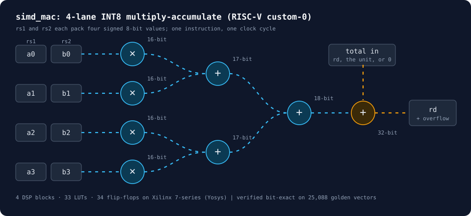
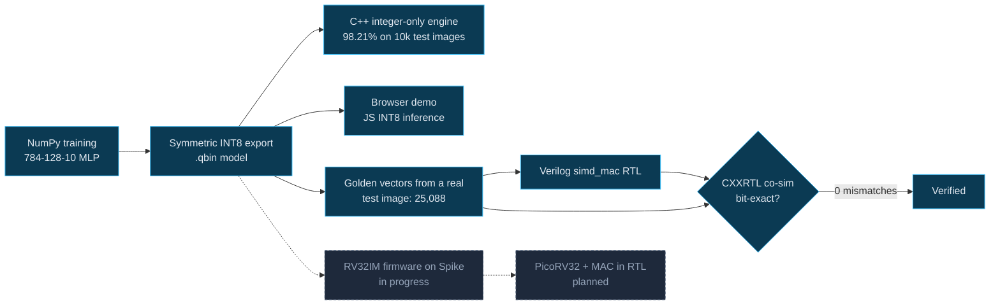
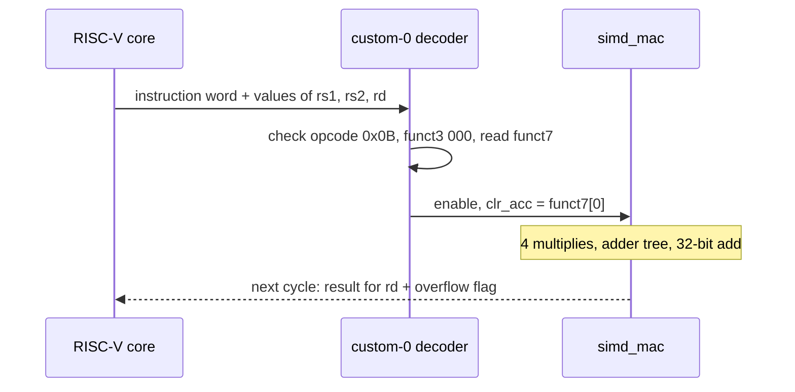
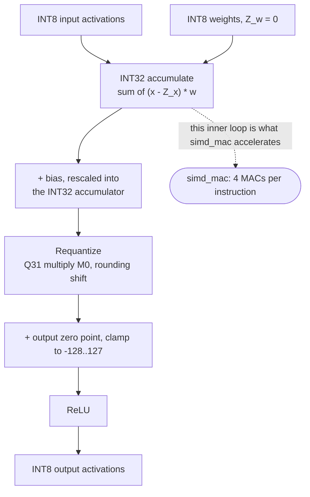
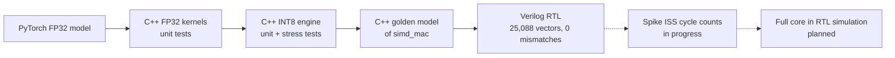
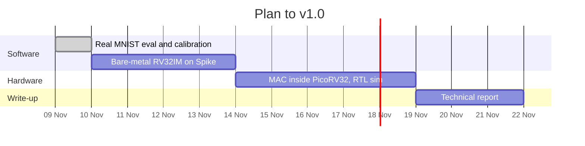

# riscv-edge-ai

Integer-only neural network inference for small RISC-V cores, with a custom 4-lane INT8 multiply-accumulate (MAC) instruction designed in Verilog.

The goal is simple: run useful AI models on cheap microcontrollers that have no floating-point unit. A 32-bit RISC-V register can hold four 8-bit values, but a plain RV32IM core multiplies them one at a time. This project builds the software side (INT8 quantization and a fixed-point runtime) and the hardware side (a SIMD MAC unit mapped to the RISC-V `custom-0` opcode), and verifies that both produce exactly the same results.

<p align="center">
  
</p>

<p align="center">
  <a href="https://sajedulislam5840.github.io/riscv-edge-ai/"><b>Live demo</b></a> ·
  <a href="#verified-results">Results</a> ·
  <a href="#how-it-fits-together">Architecture</a> ·
  <a href="#reproduce">Reproduce</a> ·
  <a href="#roadmap">Roadmap</a>
</p>

---

## Status

| Part | State |
|---|---|
| FP32 reference kernels (GEMM, ReLU, bias, softmax) | Done, unit tested |
| INT8 quantization library (affine, per-channel, Q31 requantization, BN folding, pooling, `.qbin` format) | Done, unit tested on host |
| SIMD MAC RTL (`hardware/rtl/simd_mac.v`) + `custom-0` decoder wrapper | Done, synthesized and verified against golden vectors |
| INT8 evaluation on the real MNIST test set (calibrated activations) | Done: 98.21% INT8 vs 98.23% FP32 |
| Bare-metal RV32IM firmware + cycle counts on Spike | In progress |
| Integration of the MAC into a RISC-V core (PicoRV32) | Planned |
| Technical report | Planned |

Everything listed as done below can be reproduced with the commands in [Reproduce](#reproduce).

---

## How it fits together



Solid boxes are done and verified; dashed boxes are in progress or planned.

---

## Verified results

### SIMD MAC hardware

The unit takes two 32-bit registers, each holding four signed INT8 values, and computes

```
rd = (clear ? 0 : rd) + a0*b0 + a1*b1 + a2*b2 + a3*b3
```

in one clock cycle: four 8x8 signed multipliers, a two-level adder tree, a 32-bit accumulator and an overflow flag.

**Synthesis (Yosys, no placement/routing yet):**

| Target | Multipliers | Logic | Flip-flops | Carry |
|---|---|---|---|---|
| Xilinx 7-series (`synth_xilinx`) | 4 DSP48E1 | 33 LUTs | 34 | 8 CARRY4 |
| Lattice iCE40 UP5K (`synth_ice40 -dsp`) | 4 SB_MAC16 | 67 LUT4 | 34 | 31 SB_CARRY |

Fmax has not been measured yet. That needs a place-and-route run (nextpnr / Vivado), which is on the to-do list.

**RTL verification:** `tests/gen_simd_vectors.cpp` takes the INT8 first-layer weights and a real MNIST test image and generates **25,088 test vectors**, one per instruction the firmware would issue: 128 neurons x 196 four-byte chunks, with the accumulator chained from chunk to chunk. It also checks, for every neuron, that the MAC's raw-byte result plus the folded zero-point term equals the engine's layer accumulator. The Verilog RTL, compiled to C++ with Yosys CXXRTL, matches on **all 25,088 vectors (0 mismatches)**. As a sanity check of the check itself, flipping one adder in the RTL produces 24,444 mismatches.

**ISA encoding** (R-type, opcode `0x0B` / `custom-0`):

| Instruction | funct7 | funct3 | Operation |
|---|---|---|---|
| `simd_mac` | `0000000` | `000` | `rd = rd + dot4(rs1, rs2)` |
| `simd_mac_clr` | `0000001` | `000` | `rd = dot4(rs1, rs2)` |

**How the core talks to the unit** (`simd_mac_wrapper.v`, one-cycle latency, no stalls):



Software can emit the instruction with the standard binutils `.insn` directive, without modifying the compiler:

```c
asm volatile(".insn r 0x0B, 0, 1, %0, %1, %2" : "=r"(acc) : "r"(a), "r"(b));
```

`hardware/include/simd_mac_isa.h` wraps this and provides a plain C fallback for non-RISC-V builds.

### Quantization library

- 7 test suites (FP32 kernels, quantization, stress/overflow cases) pass with `ctest`.
- INT8 weights take 4x less memory than FP32 (101.6 KB vs 406.4 KB for the 784-128-10 MLP).
**MNIST test set, 10,000 images** (`benchmarks/mnist/run_benchmark.cpp`). Activation scales are calibrated on 2,000 training images; the test set is only used for the final numbers.

| Configuration | Accuracy |
|---|---|
| FP32 reference | 98.23% |
| INT8 weights, FP32 activations | 98.23% |
| **INT8 end to end, integer-only inference** (min/max calibration) | **98.21%** |
| INT8 end to end, 99.99th-percentile clipping of the hidden layer | 98.26% |

INT8 and FP32 predict the same class on 99.84% of test images (9,984 of 10,000). The INT8 result was cross-checked with an independent NumPy implementation of the same integer pipeline, which also gives 98.21%. Min/max calibration was chosen as the main configuration before looking at test results; the percentile row is shown for comparison only.

Weights are quantized symmetrically (zero point 0, per tensor), which is what the MAC unit assumes. An asymmetric export of the same weights reaches 98.20%, so symmetric quantization costs nothing here.

Speed numbers will be reported as RISC-V cycle counts (Spike, then RTL simulation), not as x86 host timings. Host timings say nothing about the target hardware.

---

## Design notes

**Quantization.** Affine INT8 quantization `q = clamp(round(r/S) + Z, -128, 127)`. Requantization after each layer uses a precomputed Q31 multiplier and shift (`M0 * 2^-shift`), so inference needs no floating-point operations. Weights are symmetric (`Z_W = 0`), which keeps the hardware datapath to plain signed multiplies.

One quantized dense layer, as the runtime computes it:




**How the MAC fits the quantized math.** The layer needs `sum((q_x - Z_x) * w)`, but the MAC multiplies raw signed bytes. With symmetric weights this splits into `sum(q_x * w) - Z_x * sum(w)`: the first term is exactly what the instruction computes, and the second is a constant per output neuron that is folded into the bias offline. The vector generator checks this identity for every neuron.

**Why a stateless R-type instruction (and its limitation).** The accumulate form `simd_mac` reads three registers: `rs1`, `rs2` and the old value of `rd`. Most small RISC-V cores, including PicoRV32's PCPI coprocessor port, only provide two source operands. For core integration I plan to move the accumulator inside the unit (`clear` / `accumulate` / `read` instructions), which needs only two read ports. I'll document this decision in `hardware/docs/simd_mac_spec.md` when I make the change.

**Overflow.** Four products of at most 2^14 in magnitude fit in 18 bits, so the adder tree cannot overflow. Only the 32-bit accumulator can, and the unit flags it.

---

## Verification

Each layer is checked against the one before it, so an error cannot hide between two layers:



---

## Reproduce

Requirements: CMake, a C++17 compiler, Python 3. For the hardware steps, also Yosys (or `pip install yowasp-yosys` and set `YOSYS=yowasp-yosys`).

```bash
# C++ library and unit tests
cmake -S . -B build -DCMAKE_BUILD_TYPE=Release
cmake --build build -j
ctest --test-dir build

# RTL co-simulation: all 25,088 golden vectors through the Verilog
bash hardware/scripts/cosim.sh

# Synthesis resource report (Xilinx 7-series and iCE40)
bash hardware/scripts/synth.sh

# Optional: event-driven Verilog testbenches with Icarus Verilog
bash hardware/scripts/run_sim.sh
```

**MNIST evaluation** (needs Python with NumPy, and `mnist.npz` in the repo root, from https://storage.googleapis.com/tensorflow/tf-keras-datasets/mnist.npz):

```bash
python benchmarks/mnist/export_model_and_data.py   # INT8 model, test set, calibration set
./build/mnist_benchmark                            # FP32 vs INT8 accuracy table
./build/gen_simd_vectors                           # regenerate hardware/tb/golden_vectors.hex
```

To retrain from scratch: `python benchmarks/mnist/train_and_export.py` (NumPy only), then run the export again.

---

## Repository layout

```
include/engine/     tensor, quantization and kernel headers
src/                FP32 ops and INT8 quantization engine
tests/              unit tests + golden-vector generator for the RTL
benchmarks/mnist/   training/export scripts, benchmark harness, trained model (.qbin)
hardware/rtl/       simd_mac.v (datapath), simd_mac_wrapper.v (custom-0 decoder)
hardware/tb/        Verilog testbenches, CXXRTL co-sim, golden vectors
hardware/include/   C header for the custom instruction
hardware/docs/      microarchitecture spec, synthesis notes
web/                browser demo (vanilla JS, fixed-point INT8 inference)
docs/               quantization spec, benchmark notes, figures
```

---

## Roadmap



1. ~~Evaluate the INT8 pipeline on the real MNIST test set with calibrated activation scales.~~ Done (98.21%).
2. Freestanding C firmware for RV32IM (no heap, no exceptions, no standard library) running on Spike, with `rdcycle` measurements for three versions of the same GEMM: scalar, SIMD dot-product, and SIMD with an internal accumulator.
3. Attach the MAC unit to PicoRV32 and run full inference in RTL simulation. Report area and Fmax with and without the unit.
4. Short technical report.

Later: design-space exploration (2/4/8 lanes, saturation, pipelining), a small CNN workload, FPGA bring-up, and porting to other open RISC-V cores.

## Related work

This builds on well-known ideas: the RISC-V P (packed SIMD) extension has a similar 4-way INT8 multiply-accumulate (`smaqa`), and projects such as Google's CFU Playground and PULP's XpulpNN add custom ML instructions to open RISC-V cores. What this project adds is a small, fully open, end-to-end stack, from quantization to RTL, built so that every step can be checked against the previous one.

## Acknowledgements

I used AI coding assistants while developing this project. The design decisions, verification and measurements are my own, and I can explain every part of it.

## License

MIT, see [LICENSE](LICENSE).
